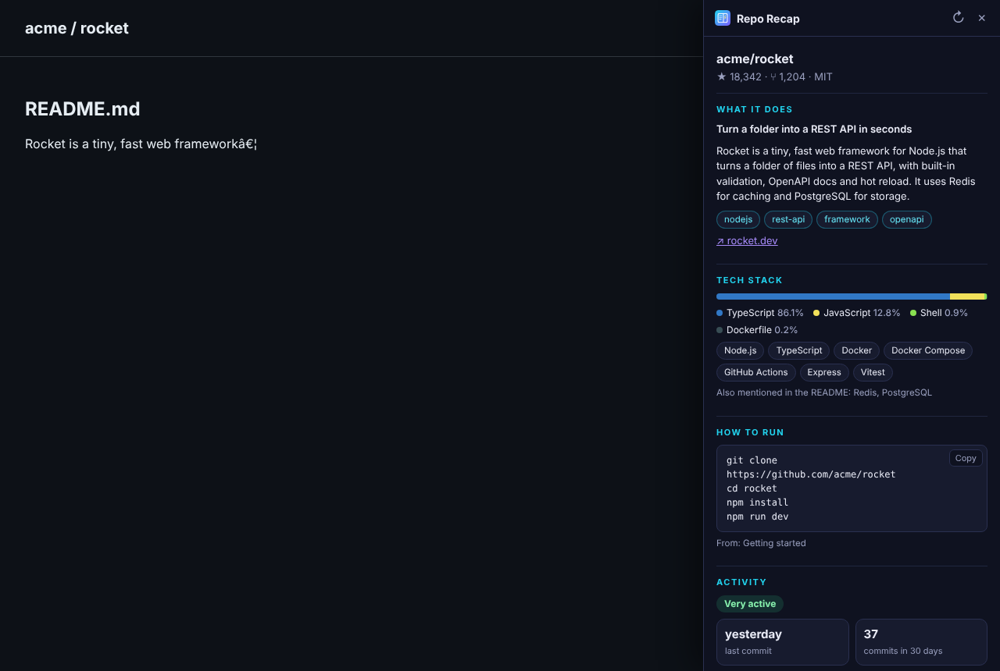

# ⚡ Repo Recap

**A sidebar on every GitHub repo that tells you what it does, what it's built with, how to run it and whether it's still alive.** Made for open-source hunting: decide in 10 seconds whether a repo is worth your time.

<p align="center"></p>

## What you get

| Section | How it works |
|---|---|
| **What it does** | the repo description, plus the first real paragraph of the README (badges, images and HTML stripped out) |
| **Tech stack** | language breakdown, tools detected from files (`package.json`, `pom.xml`, `Dockerfile`, `docker-compose.yml`, `go.mod`…) and dependencies, plus frameworks the README mentions |
| **How to run** | commands from the README's *Getting started / Install / Usage* section, or a best guess from the repo's files, with a Copy button |
| **Activity** | last commit, commits in the last 30 days, open issues, **good first issues**, and a verdict: *Very active · Active · Slowing down · Inactive · Archived* |

If a repo is active and has good first issues, it says so and links straight to them.

## Usage

Open any GitHub repo and click the **⚡ Recap** tab on the right edge. It follows you as you move between repos.

## Limits and the optional token

It uses GitHub's public REST API (about 6 requests per repo). Results are cached for 15 minutes.

- Without a token, GitHub allows **60 requests an hour** (about 10 repos).
- For more, open the extension's **Options** and paste a fine-grained token with **public repositories, read-only** access. That raises the limit to 5,000 an hour. The token is stored only in your browser and sent only to `api.github.com`.

## Privacy

It runs only on `github.com` and talks only to `api.github.com`. No analytics, no other servers.

## Install (2 minutes)

1. Download this repo: **Code → Download ZIP**, then unzip it (or `git clone` it).
2. Open `chrome://extensions` in Chrome (or Edge / Brave).
3. Turn on **Developer mode** (top right).
4. Click **Load unpacked** and choose the unzipped folder (the one with `manifest.json`).
5. Pin it from the 🧩 puzzle-piece menu so it is one click away.

## Built with

Manifest V3, plain JavaScript, Shadow DOM (so GitHub's styles and the sidebar never clash), GitHub REST API.

## Tests

`tests/test.js` loads the extension into headless Chromium with [Playwright](https://playwright.dev), opens realistic mock pages and checks the results end to end (screenshots go to the folder you pass in):

```bash
npm i -D playwright && npx playwright install chromium
node tests/test.js /tmp
```
